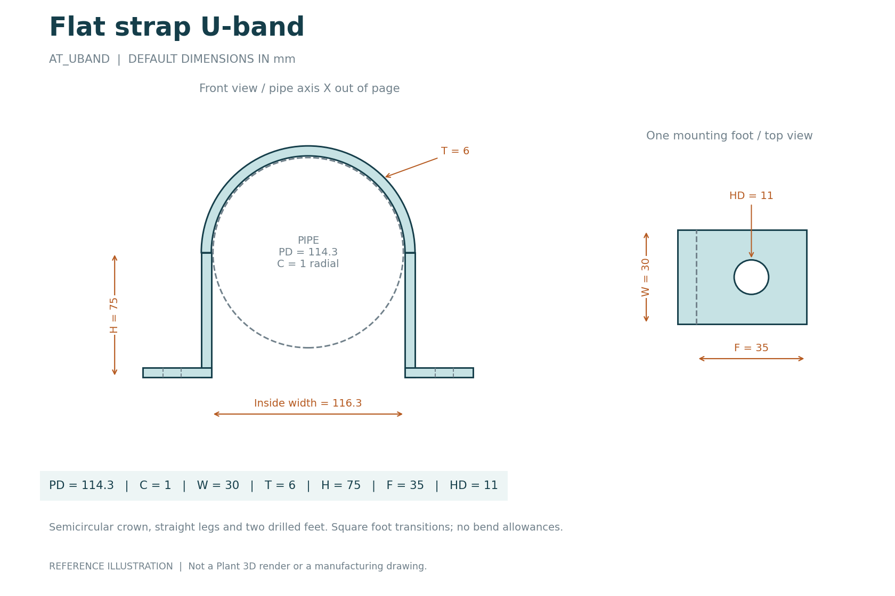

# AutoCAD Plant 3D Parametric Components

Twelve editable Python examples, with dimensioned PNG and SVG reference images. All dimensions are in **millimetres**. The library includes a **flat strap U-band with drilled mounting feet**, a separate round U-bolt body, a T-section pipe shoe, and a grooved (Victaulic-style) coupling housing.



These are source examples with geometric input checks. Plant 3D registration, solids, catalog integration, connections and isometrics still need validation in your installation. The drawings are analytical illustrations, not Plant 3D screenshots or fabrication drawings; no JIS/ASME dimensions or load/pressure rating is implied.

## Choose a component

| Component | Python source | Reference image | Main adjustable dimensions |
| --- | --- | --- | --- |
| Flat strap U-band | [AT_UBAND.py](CustomScripts/AT_UBAND.py) | [PNG](images/AT_UBAND.png) / [SVG](images/AT_UBAND.svg) | Pipe OD, clearance, width, thickness, leg depth, foot projection, mounting holes |
| Round U-bolt body | [AT_UBOLT.py](CustomScripts/AT_UBOLT.py) | [PNG](images/AT_UBOLT.png) / [SVG](images/AT_UBOLT.svg) | Pipe OD, clearance, rod diameter, leg depth |
| T-section pipe shoe | [AT_PIPE_SHOE.py](CustomScripts/AT_PIPE_SHOE.py) | [PNG](images/AT_PIPE_SHOE.png) / [SVG](images/AT_PIPE_SHOE.svg) | Pipe OD, length, depth below pipe centre, base width, plate thickness |
| Grooved coupling housing | [AT_GROOVED_COUPLING.py](CustomScripts/AT_GROOVED_COUPLING.py) | [PNG](images/AT_GROOVED_COUPLING.png) / [SVG](images/AT_GROOVED_COUPLING.svg) | Pipe OD, housing diameter and length, pipe-end gap, bolt pads and holes |
| Drilled flat flange | [AT_FLANGE.py](CustomScripts/AT_FLANGE.py) | [PNG](images/AT_FLANGE.png) / [SVG](images/AT_FLANGE.svg) | Outside diameter, bore, thickness, bolt circle, holes |
| Blind flange plate | [AT_BLIND_FLANGE.py](CustomScripts/AT_BLIND_FLANGE.py) | [PNG](images/AT_BLIND_FLANGE.png) / [SVG](images/AT_BLIND_FLANGE.svg) | Outside diameter, thickness, bolt circle, holes |
| Concentric reducer | [AT_REDUCER.py](CustomScripts/AT_REDUCER.py) | [PNG](images/AT_REDUCER.png) / [SVG](images/AT_REDUCER.svg) | Outside and bore diameters at both ends, length |
| Hollow 90-degree elbow | [AT_ELBOW90.py](CustomScripts/AT_ELBOW90.py) | [PNG](images/AT_ELBOW90.png) / [SVG](images/AT_ELBOW90.svg) | Outside diameter, bore, bend radius |
| Straight tee, equal or reducing | [AT_TEE.py](CustomScripts/AT_TEE.py) | [PNG](images/AT_TEE.png) / [SVG](images/AT_TEE.svg) | Run and branch diameters and bores, centre-to-end lengths |
| Ellipsoidal pipe cap | [AT_CAP.py](CustomScripts/AT_CAP.py) | [PNG](images/AT_CAP.png) / [SVG](images/AT_CAP.svg) | Outside diameter, wall thickness, length |
| Hollow spacer | [AT_SPACER.py](CustomScripts/AT_SPACER.py) | [PNG](images/AT_SPACER.png) / [SVG](images/AT_SPACER.svg) | Outside diameter, bore, length |
| Solid cylinder | [AT_CYLINDER.py](CustomScripts/AT_CYLINDER.py) | [PNG](images/AT_CYLINDER.png) / [SVG](images/AT_CYLINDER.svg) | Diameter, length |

[Browse all twelve image sheets](docs/GALLERY.md) or open the [overview image](images/component-gallery.jpg).

## Start with the U-band

Copy the twelve `.py` files from `CustomScripts` into your configured shared-content folder's `CPak Common\CustomScripts` directory, then follow [installation and testing](docs/INSTALLATION.md). Once registered, test in a scratch drawing:

```lisp
(arxload "PnP3dACPAdapter")
(testacpscript "AT_UBAND")
```

The default U-band fits around a 114.3 mm pipe with 1 mm radial clearance. It has a 30 mm wide, 6 mm thick strap, 75 mm centre-to-foot depth, 35 mm projecting feet and 11 mm mounting holes. Its leg-to-foot transitions are square; bend radii/allowances, bolts and load calculations are outside this example.

The `varmain` imports come from Plant 3D. Ordinary Python cannot run the CAD geometry. Each component is self-contained; its filename and entry-point function must match.

## Documentation

- [Component parameters and coordinates](docs/COMPONENTS.md).
- [Commands for default, changed-size and invalid-input tests](examples/plant3d-test-commands.lsp).
- [Validation record](docs/VALIDATION.md).
- [Autodesk forum research and references](docs/FORUM_REFERENCES.md), including decompiled-script discussions and the Plant 3D 2026.2 reload changes.

## Offline checks and image regeneration

Using Python 3.10 or later from the repository folder:

```powershell
python -B -m unittest discover -s tests -v
```

The tests record primitive calls and check dimensions, hole/foot clearances, reference points, temporary-object cleanup and image/source consistency. They do not simulate Autodesk's solid kernel. GitHub Actions runs the checks on Python 3.10, 3.11, 3.13 and 3.14.

The preview generator reads defaults from the actual source files. To regenerate the reference sheets after changing those defaults:

```powershell
python -m pip install -r tools/requirements-previews.txt
python tools/render_previews.py
```

Only image generation needs these optional packages; component scripts and offline tests do not. PNG/SVG images are documentation assets, not automatically registered Spec Editor thumbnails.
