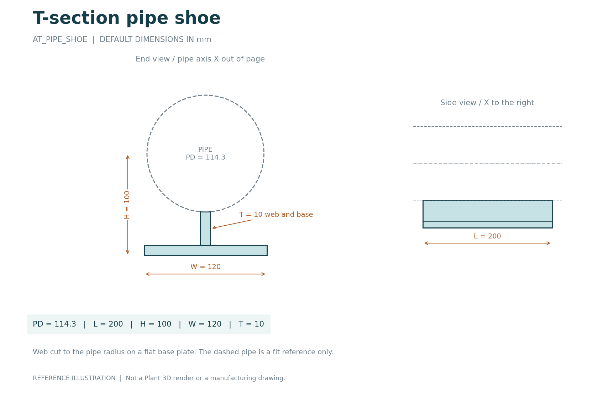
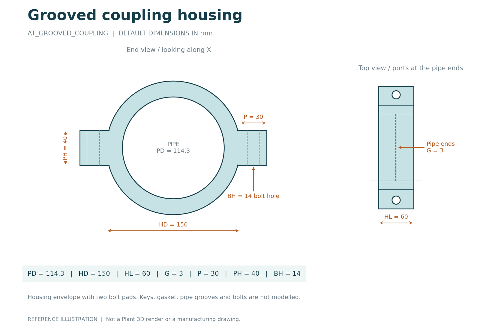
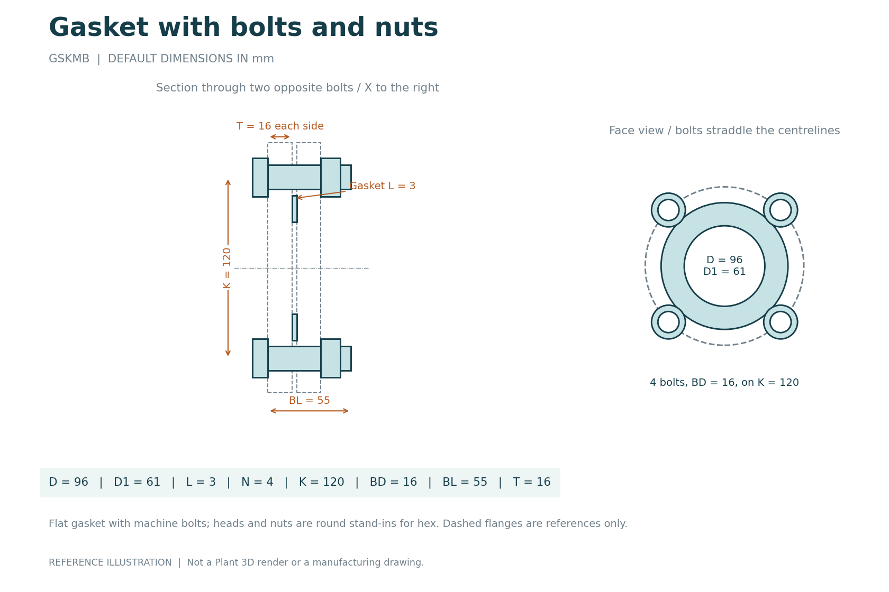
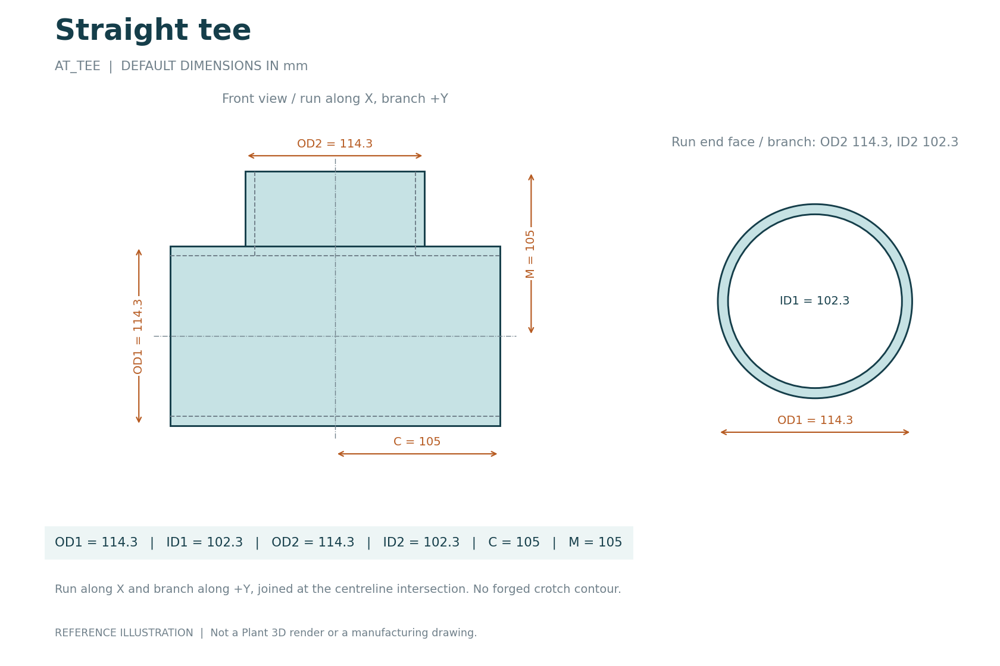
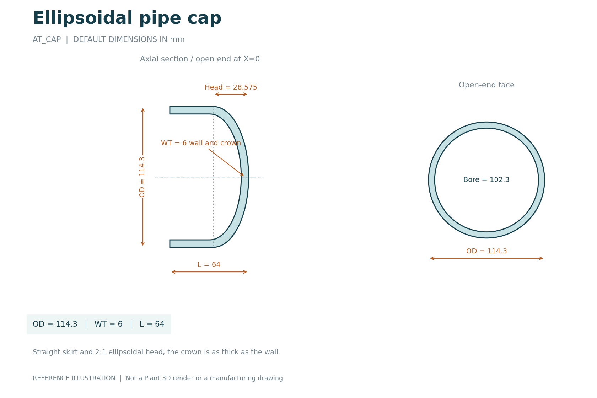

# Component image gallery

All thirteen sheets use source-code defaults in millimetres. They are analytical reference illustrations, not Plant 3D renders or manufacturing drawings. The pipe outline in the clamp, shoe and coupling sheets is a dashed fit reference; those scripts do not add a pipe solid.

## Flat strap U-band

[Python source](../CustomScripts/AT_UBAND.py) | [Editable SVG](../images/AT_UBAND.svg)

## Round U-bolt body

[Python source](../CustomScripts/AT_UBOLT.py) | [Editable SVG](../images/AT_UBOLT.svg)

## T-section pipe shoe

[Python source](../CustomScripts/AT_PIPE_SHOE.py) | [Editable SVG](../images/AT_PIPE_SHOE.svg)

## Grooved coupling housing

[Python source](../CustomScripts/AT_GROOVED_COUPLING.py) | [Editable SVG](../images/AT_GROOVED_COUPLING.svg)

## Drilled flat flange

[Python source](../CustomScripts/AT_FLANGE.py) | [Editable SVG](../images/AT_FLANGE.svg)

## Blind flange plate

[Python source](../CustomScripts/AT_BLIND_FLANGE.py) | [Editable SVG](../images/AT_BLIND_FLANGE.svg)

## Gasket with bolts and nuts

[Python source](../CustomScripts/GSKMB.py) | [Editable SVG](../images/GSKMB.svg) | [Guide](GSKMB.md)

## Concentric reducer

[Python source](../CustomScripts/AT_REDUCER.py) | [Editable SVG](../images/AT_REDUCER.svg)

## Hollow 90-degree elbow

[Python source](../CustomScripts/AT_ELBOW90.py) | [Editable SVG](../images/AT_ELBOW90.svg)

## Straight tee

[Python source](../CustomScripts/AT_TEE.py) | [Editable SVG](../images/AT_TEE.svg)

## Ellipsoidal pipe cap

[Python source](../CustomScripts/AT_CAP.py) | [Editable SVG](../images/AT_CAP.svg)

## Hollow spacer

[Python source](../CustomScripts/AT_SPACER.py) | [Editable SVG](../images/AT_SPACER.svg)

## Solid cylinder

[Python source](../CustomScripts/AT_CYLINDER.py) | [Editable SVG](../images/AT_CYLINDER.svg)

