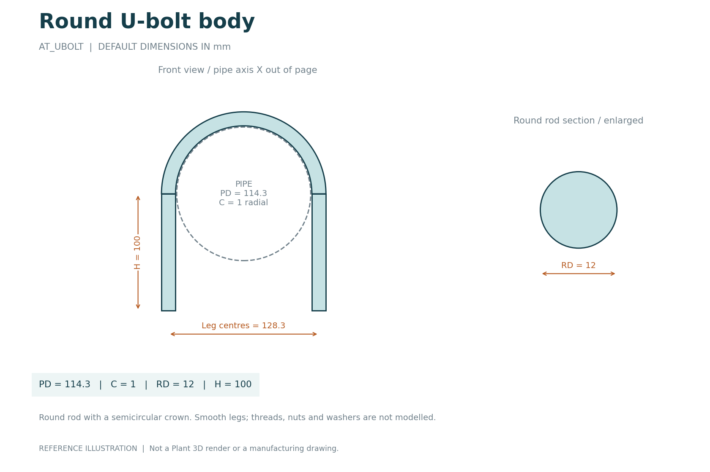
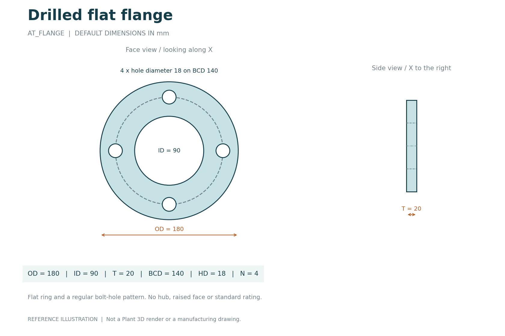
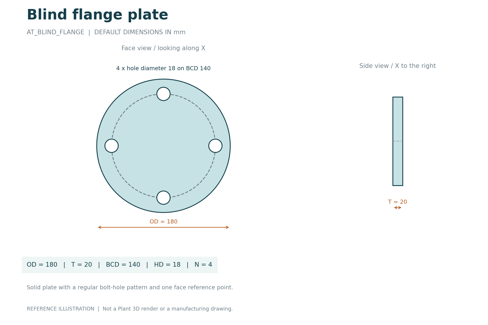
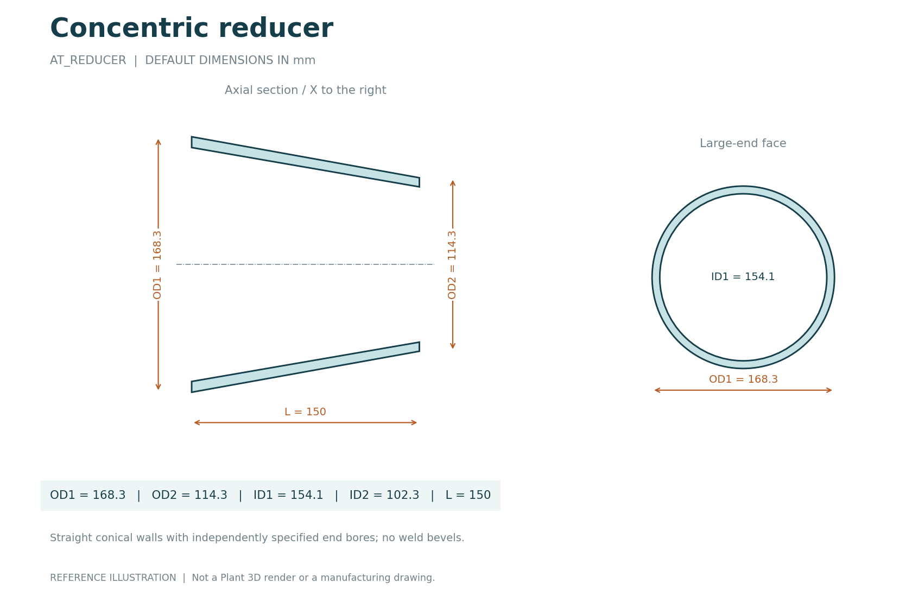
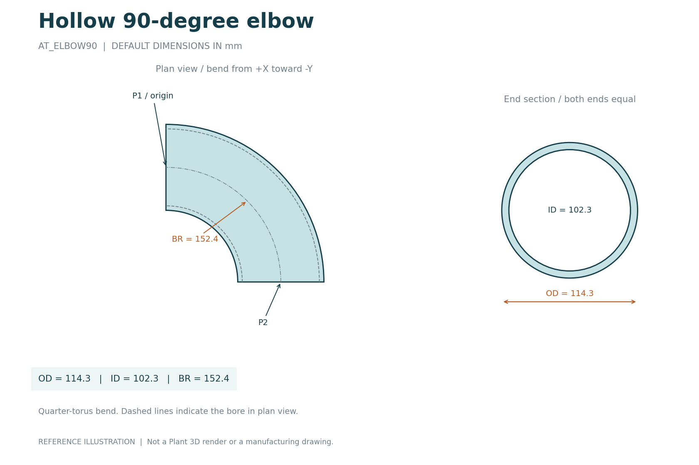
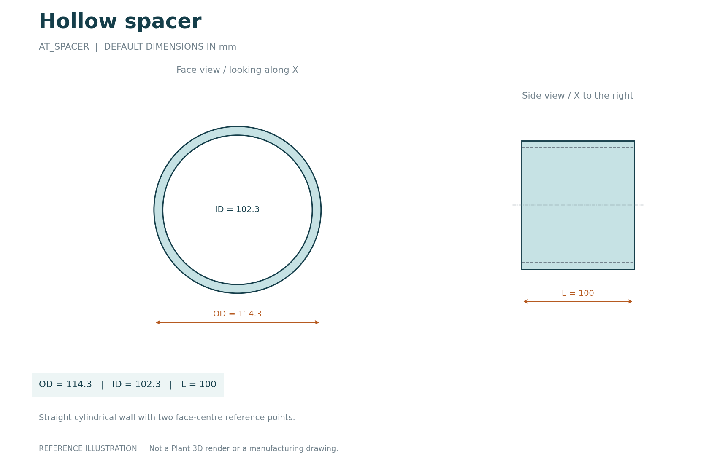
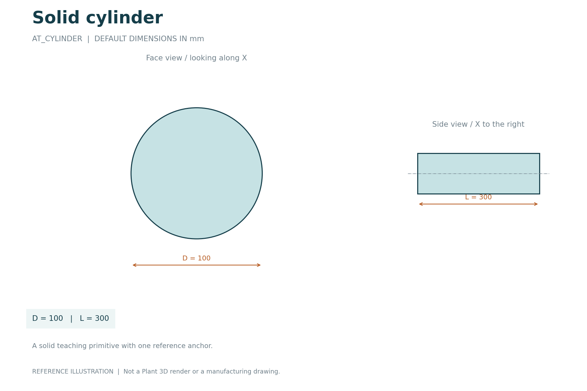

# Component image gallery

All eight sheets use source-code defaults in millimetres. They are analytical reference illustrations, not Plant 3D renders or manufacturing drawings. The pipe outline in the clamp sheets is a dashed fit reference; no pipe solid is added by the clamp scripts.

## Flat strap U-band

[Python source](../CustomScripts/AT_UBAND.py) | [Editable SVG](../images/AT_UBAND.svg)

## Round U-bolt body

[Python source](../CustomScripts/AT_UBOLT.py) | [Editable SVG](../images/AT_UBOLT.svg)

## Drilled flat flange

[Python source](../CustomScripts/AT_FLANGE.py) | [Editable SVG](../images/AT_FLANGE.svg)

## Blind flange plate

[Python source](../CustomScripts/AT_BLIND_FLANGE.py) | [Editable SVG](../images/AT_BLIND_FLANGE.svg)

## Concentric reducer

[Python source](../CustomScripts/AT_REDUCER.py) | [Editable SVG](../images/AT_REDUCER.svg)

## Hollow 90-degree elbow

[Python source](../CustomScripts/AT_ELBOW90.py) | [Editable SVG](../images/AT_ELBOW90.svg)

## Hollow spacer

[Python source](../CustomScripts/AT_SPACER.py) | [Editable SVG](../images/AT_SPACER.svg)

## Solid cylinder

[Python source](../CustomScripts/AT_CYLINDER.py) | [Editable SVG](../images/AT_CYLINDER.svg)

